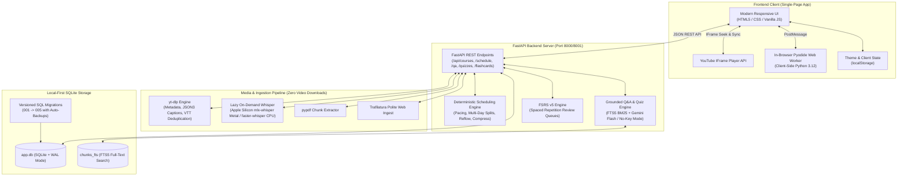
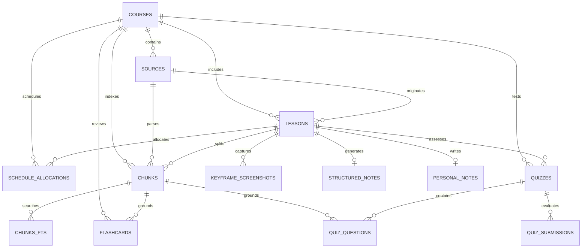
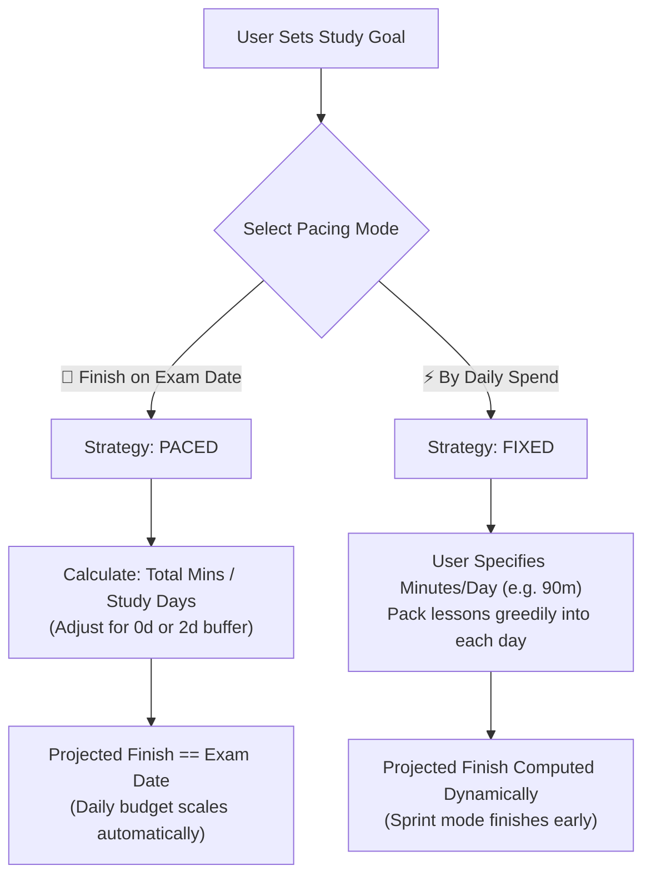
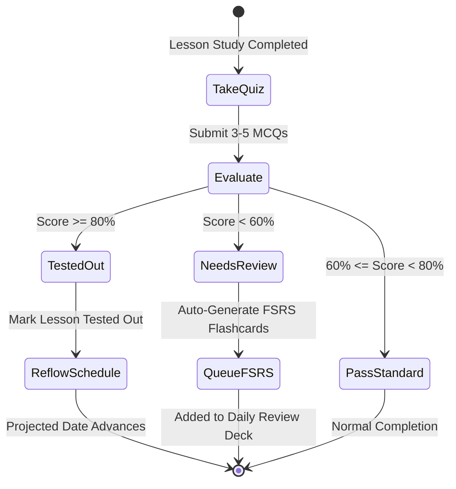

# Learn LMS • Complete System Architecture & Project Documentation

> **Autonomous, Local-First Personal LMS & High-Stakes Exam-Prep Platform**  
> *Target Architecture: macOS Apple Silicon (M-series, ARM64) with cross-platform Python compatibility.*  
> *Design Influences: CourseIt.xyz, Gemini NotebookLM, Anki / FSRS, and Khan Academy.*

---

## Table of Contents
1. [Executive Summary & Non-Technical Overview](#1-executive-summary--non-technical-overview)
   - [The Problem Solved](#the-problem-solved)
   - [Core Learning Philosophy](#core-learning-philosophy)
   - [User Journey & High-Level Flow](#user-journey--high-level-flow)
2. [End-to-End System Architecture](#2-end-to-end-system-architecture)
   - [High-Level Architecture Diagram](#high-level-architecture-diagram)
   - [Component Breakdown](#component-breakdown)
3. [Repository Directory & File Structure](#3-repository-directory--file-structure)
4. [Database Architecture & Schema Design](#4-database-architecture--schema-design)
   - [Entity-Relationship Diagram](#entity-relationship-diagram)
   - [Table Definitions & FTS5 Indexing](#table-definitions--fts5-indexing)
   - [Migration System & Automated Backups](#migration-system--automated-backups)
5. [The Deterministic Scheduling Engine](#5-the-deterministic-scheduling-engine)
   - [Mathematical Foundations & Formulas](#mathematical-foundations--formulas)
   - [Dual Pacing Strategies (Finish on Exam vs. Fixed Daily Spend)](#dual-pacing-strategies)
   - [Multi-Day Lesson Splitting Loop](#multi-day-lesson-splitting-loop)
   - [Behind-Schedule Detection, Compression & Undo Snapshots](#behind-schedule-detection-compression--undo-snapshots)
6. [Media Ingestion, Transcription & Caching](#6-media-ingestion-transcription--caching)
   - [Zero-Download YouTube Streaming](#zero-download-youtube-streaming)
   - [Rolling Caption VTT Deduplication](#rolling-caption-vtt-deduplication)
   - [Lazy Local Whisper on Apple Silicon (MLX & Faster-Whisper)](#lazy-local-whisper-on-apple-silicon)
   - [Multimodal Ingestion (PDFs & Web Articles)](#multimodal-ingestion)
7. [Citation-Grounded AI Studio (NotebookLM Style)](#7-citation-grounded-ai-studio-notebooklm-style)
   - [BM25 Chunk Retrieval & Context Assembly](#bm25-chunk-retrieval--context-assembly)
   - [Grounding & Verbatim Evidence Verification](#grounding--verbatim-evidence-verification)
   - [Free-Tier LLM Gateway & No-Key Mode](#free-tier-llm-gateway--no-key-mode)
8. [Active Recall Quizzes & FSRS v5 Spaced Repetition](#8-active-recall-quizzes--fsrs-v5-spaced-repetition)
   - [Diagnostic Pre-Tests & Testing Out](#diagnostic-pre-tests--testing-out)
   - [Citation-Grounded Quiz Engine & Mastery Loop](#citation-grounded-quiz-engine--mastery-loop)
   - [Official FSRS v5 Spaced Repetition Algorithm](#official-fsrs-v5-spaced-repetition-algorithm)
   - [Dynamic Exam-Proximity Retention Scaling](#dynamic-exam-proximity-retention-scaling)
9. [Frontend Design System & UX Layout](#9-frontend-design-system--ux-layout)
   - [Layout Hierarchy & Command Center Bar](#layout-hierarchy--command-center-bar)
   - [The 6 Studio Tabs & Signature Themes](#the-6-studio-tabs--signature-themes)
   - [Full System-Wide Editability](#full-system-wide-editability)
   - [In-Browser Pyodide Web Worker Execution](#in-browser-pyodide-web-worker-execution)
   - [Dual High-Contrast Theme System (WCAG AA Compliant)](#dual-high-contrast-theme-system)
10. [REST API Specifications](#10-rest-api-specifications)
11. [Quality Assurance, Testing & Observability](#11-quality-assurance-testing--observability)
    - [Test Matrix & Automated Verification](#test-matrix--automated-verification)
    - [Color-Coded Terminal & F12 Console Logging](#color-coded-terminal--f12-console-logging)
12. [Launcher & Single-Command Deployment (`run.py`)](#12-launcher--single-command-deployment-runpy)

---

## 1. Executive Summary & Non-Technical Overview

### The Problem Solved
University students studying complex STEM topics (e.g. Theory of Computation, Database Management Systems, Computer Networks, Operating Systems) face a common set of frustrations:
1. **Overwhelming, Unstructured Media**: YouTube marathon playlists (often 50–120 videos) lack calendar pacing. Students don't know how many videos to watch per day to finish before their exam.
2. **Passive Video Watching**: Watching lectures without active recall leads to the "illusion of competence." Students forget concepts within 48 hours.
3. **Rigid Calendars**: Life happens. If a student misses one day or watches lectures at $1.5\times$ speed, standard Google Calendar or Notion schedules break and require tedious manual recalculation.
4. **AI Hallucinations**: Standard LLM chat tools invent formulas, cite non-existent sources, or give generic answers not covered in the student's actual university syllabus.
5. **Subscription Fatigue & Cloud Lock-In**: Most study software charges monthly SaaS fees, stores personal notes on remote servers, and requires constant cloud connectivity.

### Core Learning Philosophy
**Learn LMS** solves these problems with a unified, local-first web application based on five proven pedagogy models:
- **CourseIt Model**: Diagnostic pre-tests, day-wise time-budgeted lessons, and flexible deadline pacing.
- **NotebookLM Model**: Multi-source grounding where notes, summaries, and Q&A answers cite exact verbatim timestamps and textbook excerpts.
- **BiliNote Model**: Video timestamp synchronization, rich personal notes with Markdown toolbars, and visual keyframe captures.
- **Anki / FSRS Spaced Repetition Model**: Target-retention spaced repetition scheduling that automatically intensifies review frequency as exams approach.
- **Khan Academy Model**: Mastery loops where scoring $\ge 80\%$ on a topic allows a student to "Test Out" and instantly shrink their remaining study schedule.

### User Journey & High-Level Flow
1. **Set a Goal**: The student inputs a goal query (e.g. `"DBMS end-term in 3 weeks, 90 min/day"`) or pastes a YouTube marathon lecture/playlist URL.
2. **Source Ingestion & Chapter Splitting**: The app analyzes the content. Marathon videos are split into 15–20 minute chapters; playlists are structured into individual lessons.
3. **Curriculum Review & Example Skipping**: When study time is tight, the student clicks **"⚡ Skip All Examples"** to exclude practice question videos and retain only core conceptual theory.
4. **Automated Calendar Pacing**: The student selects their pacing mode:
   - **"Finish on Exam Date"**: Lessons are mathematically distributed across available study days so learning finishes exactly on the target date (or 2 days early to reserve a dedicated revision buffer).
   - **"By Daily Spend"**: The student chooses fixed minutes per day (e.g. 60 min), and the projected finish date is calculated dynamically.
5. **Interactive Study Studio**: The student watches videos via an embedded player, reviews citation notes, writes personal formatted notes, asks questions to the grounded NotebookLM AI, takes quick multiple-choice quizzes, reviews 3D flipping flashcards, or tests Python scripts in an in-browser sandbox.
6. **Adaptive Reflow**: If the student marks a lesson complete, skips an item, or changes their playback speed to $1.25\times$, the entire timeline recalculates in milliseconds with a 1-click **Undo** option.

---

## 2. End-to-End System Architecture

### High-Level Architecture Diagram



### Component Breakdown
1. **FastAPI Application (`backend/main.py`)**: High-performance asynchronous Python web framework providing typed OpenAPI contracts, dependency injection for SQLite connections, request-logging middleware, and no-cache development headers.
2. **Deterministic Scheduling Engine (`backend/scheduler/engine.py`)**: 100% pure Python, unit-tested scheduling engine free of external network or LLM dependencies. Uses local calendar dates, injectable clocks, and mathematical time allocation.
3. **Multi-Source Ingestion Pipeline (`backend/services/`)**:
   - `youtube.py`: Communicates with `yt-dlp` to extract playlist and chapter metadata without saving video files.
   - `transcription.py`: Fetches manual/auto-generated subtitles, deduplicates rolling VTT lines, or triggers lazy per-lesson Whisper on Apple Silicon Metal GPU.
   - `pdf_ingest.py` & `web_ingest.py`: Parses textbook PDFs and web documentation into structured chunks.
4. **Grounded AI Gateway (`backend/services/qa_engine.py` & `quiz_engine.py`)**: Performs BM25 keyword matching across ingested chunks and synthesizes citation-grounded notes, Q&A answers, and multiple-choice quizzes.
5. **FSRS Engine (`backend/services/fsrs_engine.py`)**: Implements Free Spaced Repetition Scheduling v5 to schedule card intervals based on memory stability and item difficulty.
6. **Frontend Single-Page App (`frontend/templates/index.html` & `frontend/static/js/app.js`)**: A zero-build-step, reactive vanilla JavaScript application featuring custom responsive layouts, CourseIt-inspired day groups, a NotebookLM studio drawer, and full keyboard navigation.

---

## 3. Repository Directory & File Structure

```
Study/
├── .env                              # API keys (GEMINI_API_KEY) and local overrides (ignored by git)
├── .env.example                      # Template for environment configuration
├── .gitignore                        # Strict rules excluding .venv, *.db, data/, cache, and builds
├── DECISIONS.md                      # Architecture Decision Record (ADR) logging 1-line rationales
├── FEEDBACK.md                       # User notes and milestone feedback applied to development
├── PROGRESS.md                       # Milestone tracking checklist and verification audit
├── README.md                         # Quickstart guide, feature highlights, and test summary
├── PROJECT_OVERVIEW.md               # (This file) Complete technical & non-technical documentation
├── requirements.txt                  # Pinned dependencies (fastapi, uvicorn, yt-dlp, fsrs, etc.)
├── pytest.ini                        # Pytest configuration and async test mode settings
├── run.py                            # Cross-platform single-command launcher & environment bootstrap
├── openapi.json                      # Locked, exported OpenAPI 3.1.0 schema specification
│
├── backend/                          # Backend Python Codebase
│   ├── __init__.py
│   ├── config.py                     # Environment variables, PATH setup, and directory paths
│   ├── database.py                   # SQLite connection manager, row factories, and backup utilities
│   ├── main.py                       # FastAPI application entrypoint, middleware, and route mounting
│   ├── models/
│   │   ├── __init__.py
│   │   └── schemas.py                # Pydantic v2 schemas for requests, responses, and diffs
│   ├── routers/                      # REST API Endpoints by domain
│   │   ├── courses.py                # Course CRUD, filtering, export, and lesson management
│   │   ├── schedule.py               # Allocation toggling, rescheduling, replan, compress, and undo
│   │   ├── sources.py                # Source approval, PDF upload, and URL ingestion
│   │   ├── transcripts.py            # On-demand subtitle fetch & Whisper transcription
│   │   ├── notes.py                  # Structured AI notes & editable personal notes
│   │   ├── qa.py                     # Citation-grounded NotebookLM Q&A endpoints
│   │   ├── quizzes.py                # Grounded quiz generation, submission, and mastery loop
│   │   ├── flashcards.py             # FSRS card review, interval rating, and manual card CRUD
│   │   ├── screenshots.py            # Keyframe bookmarking and gallery endpoints
│   │   └── settings.py               # API key testing, storage vacuum, and yt-dlp update
│   ├── scheduler/
│   │   ├── __init__.py
│   │   └── engine.py                 # Deterministic scheduling math, multi-day splits, and compression
│   ├── services/                     # Business logic and external tool integrations
│   │   ├── youtube.py                # yt-dlp wrapper for metadata and chapter extraction
│   │   ├── transcription.py          # json3 deduplication, mlx-whisper, and faster-whisper
│   │   ├── pdf_ingest.py             # pypdf document chunker
│   │   ├── web_ingest.py             # Polite web article reader with robots.txt enforcement
│   │   ├── qa_engine.py              # FTS5 search, prompt synthesis, and citation verification
│   │   ├── quiz_engine.py            # Citation-grounded MCQ builder and evaluation
│   │   ├── fsrs_engine.py            # FSRS v5 card state machine and retention scaler
│   │   ├── notes.py                  # Grounded notes synthesis
│   │   └── screenshots.py            # FFmpeg keyframe capture service
│   └── migrations/                   # Versioned SQL Migration Runner
│       ├── runner.py                 # Applies pending migrations with automated pre-backup
│       └── versions/                 # Atomic SQL migration files
│           ├── 001_initial_schema.sql
│           ├── 002_scheduling_strategy_and_lesson_filters.sql
│           ├── 003_screenshots_and_transcripts.sql
│           ├── 004_qa_and_sources.sql
│           └── 005_quizzes_and_fsrs.sql
│
├── frontend/                         # Frontend Single-Page Application
│   ├── static/
│   │   └── js/
│   │       ├── app.js                # Core UI logic, reactive DOM, modals, and API client
│   │       └── pyodide_worker.js     # Web Worker executing Python 3.12 client-side via Pyodide
│   └── templates/
│       └── index.html                # Semantic HTML5 shell, Tailwind utility classes, and modals
│
├── tests/                            # Comprehensive Automated Test Suite
│   ├── test_scheduler.py             # Unit tests for scheduling math, splits, speeds, and compression
│   ├── test_yt_service.py            # Metadata extraction, chapters, and version tests
│   ├── test_migrations.py            # Schema migration and automated backup verification
│   ├── test_integration_pipeline.py  # End-to-end golden flow (Course -> Sources -> Schedule -> Study)
│   ├── test_live_browser_ui.py       # Playwright browser tests (Themes, Editing, Modals, Pacing)
│   └── ...                           # Domain tests for FSRS, Quizzes, Transcripts, and Ingestion
│
├── data-dev/                         # Local development database and asset storage
│   ├── app.db                        # SQLite database file
│   └── backups/                      # Pre-migration automated database snapshots
│
└── preview_screenshots/              # High-resolution UI captures for visual regression audits
```

---

## 4. Database Architecture & Schema Design

### Entity-Relationship Diagram



### Table Definitions & FTS5 Indexing

1. **`courses`**: Top-level study goals.
   - Fields: `id`, `title`, `goal_query`, `target_date`, `minutes_per_day`, `playback_speed` (e.g. 1.25), `rest_days` (JSON array), `revision_buffer_days` (default 2), `schedule_strategy` (`'paced'` vs `'fixed'`), `created_at`.
2. **`sources`**: Ingested learning materials.
   - Fields: `id`, `course_id`, `source_type` (`'youtube_video'`, `'youtube_playlist'`, `'pdf'`, `'url'`), `title`, `url`, `external_id`, `is_approved`, `total_duration_sec`.
3. **`lessons`**: Atomic learning units.
   - Fields: `id`, `course_id`, `source_id`, `title`, `summary`, `video_id`, `video_url`, `start_sec`, `end_sec`, `raw_duration_sec`, `priority` (`'core'` vs `'deep-dive'`), `order_index`, `chapter_title`, `is_tested_out`, `is_excluded`.
4. **`schedule_allocations`**: Day-by-day lesson allocations.
   - Fields: `id`, `course_id`, `lesson_id`, `scheduled_date` (`YYYY-MM-DD`), `split_index`, `split_count`, `allocated_start_sec`, `allocated_end_sec`, `effective_minutes`, `is_completed`, `completed_at`, `is_skipped`.
5. **`chunks` & `chunks_fts`**: Content chunks and SQLite FTS5 index.
   - Fields: `id`, `course_id`, `source_id`, `lesson_id`, `chunk_index`, `text_content`, `token_count`, `timestamp_start_sec`, `timestamp_end_sec`, `page_number`.
   - Indexed via SQLite FTS5 using the BM25 ranking algorithm:
     ```sql
     CREATE VIRTUAL TABLE chunks_fts USING fts5(
         text_content,
         content='chunks',
         content_rowid='rowid'
     );
     ```
6. **`quizzes`, `quiz_questions` & `quiz_submissions`**: Grounded active recall assessments.
   - Fields: Question prompt, options (JSON array of 4 choices), `correct_option_index`, `explanation`, `grounding_chunk_id`, `grounding_quote`.
7. **`flashcards`**: Spaced repetition cards driven by FSRS v5.
   - Fields: `id`, `course_id`, `lesson_id`, `front`, `back`, `state` (`new`, `learning`, `review`, `relearning`), `due_date`, `stability`, `difficulty`, `elapsed_days`, `scheduled_days`, `reps`, `lapses`, `last_review`.
8. **`personal_notes`**: User-authored Markdown notes with formatting and autosaves.
9. **`schedule_snapshots`**: Stores JSON snapshots of prior schedules to enable instant 1-click **Undo**.

### Migration System & Automated Backups
- Migrations are tracked in `schema_migrations` (`version`, `name`, `applied_at`).
- Before applying any pending migration script, `backend/migrations/runner.py` creates a timestamped physical copy of `app.db` in `data-dev/backups/`.
- Migrations are strictly non-destructive: existing tables are modified using additive `ALTER TABLE` statements.

---

## 5. The Deterministic Scheduling Engine

The scheduling engine (`backend/scheduler/engine.py`) is written in pure Python without third-party mathematical solvers or external LLM dependencies. It accepts an injectable `clock` function so all scheduling functions can be deterministically unit-tested with synthetic dates.

### Mathematical Foundations & Formulas

#### 1. Playback Speed Scaling
Effective study time scales inversely with video playback speed:
$$\text{effective\_minutes} = \frac{\text{raw\_seconds}}{60 \times \text{playback\_speed}}$$
*Example*: A 60-minute raw video at $1.25\times$ speed requires $48.0$ effective study minutes. At $1.5\times$ speed, it requires $40.0$ effective minutes.

#### 2. Paced Daily Target Budget
In `"paced"` mode, the engine distributes remaining effective minutes across the exact number of active study days available:
$$\text{active\_study\_days} = \text{CalendarDays}(\text{today}, \text{target\_date} - \text{revision\_buffer}) - \text{RestDays}$$
$$\text{effective\_daily\_budget} = \max\left(5.0, \, \frac{\sum \text{remaining\_effective\_minutes}}{\text{active\_study\_days}}\right)$$

### Dual Pacing Strategies



1. **🎯 Finish on Exam Date (`schedule_strategy = "paced"`)**:
   - Spreads the syllabus evenly so the final topic completes on the target exam date (if `revision_buffer_days = 0`) or directly before the revision buffer (if `revision_buffer_days = 2`).
   - The user sees: `Projected Finish: 2026-12-22 (✓ Aligned with Exam Date) • Daily Target: ~31 min/day`.
2. **⚡ By Daily Spend (`schedule_strategy = "fixed"`)**:
   - The user specifies an exact daily study budget (e.g. $90\text{ min/day}$).
   - The engine packs $90$ minutes of video into each day starting today, finishing as early as possible.
   - The user sees: `Projected Finish: 2026-11-30 (⚡ Sprint mode: 10 days) • Daily Spend: 90 min/day`.

### Multi-Day Lesson Splitting Loop
When a single lecture or chapter exceeds a day's remaining study budget, the engine splits it across consecutive study days:
1. Calculates remaining capacity on `curr_date`.
2. Allocates `[current_split_start, current_split_start + slice_seconds]` to Day 1 with `split_index = 0`.
3. Advances `curr_date` to the next valid study day (skipping rest days).
4. Allocates the remaining slice to Day 2 with `split_index = 1` and `split_count = 2`.
5. The UI displays both segments: `Part 1 of 2 [00:00 - 32:15]` and `Part 2 of 2 [32:15 - 58:00]`.

### Behind-Schedule Detection, Compression & Undo Snapshots
- **Behind-Schedule Condition**: If overdue uncompleted lessons cause the projected finish date to encroach on the 2-day revision buffer, `is_behind_schedule` triggers an amber alert banner.
- **One-Click Compression**:
  - Drops lowest-priority `deep-dive` topics starting from the end of the syllabus.
  - If dropping deep-dives still cannot fit all `core` topics before the deadline, the engine calculates the exact deficit:
    $$\text{deficit\_minutes} = \text{total\_core\_minutes} - (\text{days} \times \text{minutes\_per\_day})$$
    The user is prompted with options to either increase daily study minutes or extend the deadline.
- **Undo Snapshots**:
  - Before modifying allocations, the engine serializes the current schedule to `schedule_snapshots`.
  - A notification banner appears with the diff: `Finish: 2026-12-19 -> 2026-12-15 • Dropped 3 deep-dive topics`.
  - Clicking **"Undo Change"** restores the previous snapshot instantly.

---

## 6. Media Ingestion, Transcription & Caching

### Zero-Download YouTube Streaming
- **Official YouTube IFrame Player API**: The application never downloads, converts, or stores full video files on disk. Videos are streamed directly from YouTube inside an embedded player.
- **Microsecond Seeking**: All timestamp citations (e.g. `[14:25]`) are interactive JavaScript pills that call `ytPlayer.seekTo(seconds, true)` and trigger instant playback.

### Rolling Caption VTT Deduplication
YouTube auto-generated subtitles use rolling VTT windows where each line repeats phrases from the previous line. Learn LMS implements a sliding-window text deduplication algorithm in `backend/services/transcription.py`:
```python
def deduplicate_rolling_captions(lines: List[Tuple[float, float, str]]) -> List[Dict]:
    """Eliminates overlapping prefix repetitions from YouTube auto-captions."""
    deduped = []
    prev_text = ""
    for start, end, text in lines:
        cleaned = text.strip()
        if prev_text and cleaned.startswith(prev_text):
            cleaned = cleaned[len(prev_text):].strip()
        elif prev_text and prev_text.endswith(cleaned):
            continue
        if cleaned:
            deduped.append({"start": start, "end": end, "text": cleaned})
            prev_text = cleaned
    return deduped
```

### Lazy Local Whisper on Apple Silicon
When videos lack captions (or for uploaded audio files):
1. **Lazy Execution**: The system transcribes only the specific lesson the student is studying, rather than transcribing an entire multi-hour playlist upfront.
2. **Apple Silicon Hardware Acceleration**:
   - On macOS ARM64: Uses **`mlx-whisper`** (`whisper-small-mlx`), leveraging Apple Silicon Metal GPU unified memory without requiring PyTorch.
   - On Linux/Windows/CPU: Falls back to **`faster-whisper`** with `int8` quantization.
3. **Storage Protection**: Audio slices are downloaded into a temporary scratch directory, transcribed into text chunks, and deleted from disk immediately.

### Multimodal Ingestion
- **Textbook PDFs (`backend/services/pdf_ingest.py`)**: Ingests textbook chapters using `pypdf`, tracking page numbers and bounding text into 300–600 token chunks indexed in SQLite FTS5.
- **Web Articles (`backend/services/web_ingest.py`)**: Uses `trafilatura` to extract clean article text from documentation sites (e.g. GeeksforGeeks, Wikipedia, official docs) with user-agent identification and `robots.txt` compliance.

---

## 7. Citation-Grounded AI Studio (NotebookLM Style)

### BM25 Chunk Retrieval & Context Assembly
When a student asks a conceptual question or requests structured notes:
1. The search query is matched against SQLite's `chunks_fts` virtual table using BM25 ranking.
2. The top 5–8 most relevant chunks are retrieved with exact start timestamps or page numbers.
3. Chunks are assembled into a grounded prompt context.

### Grounding & Verbatim Evidence Verification
The LLM gateway enforces strict citation rules:
- Every factual claim must include a citation link referencing a specific chunk ID or timestamp (e.g. `[ref:chk_...]` or `[MM:SS]`).
- The answer must cite exact verbatim phrases from the source text.
- If the retrieved passages do not contain sufficient evidence to answer the query, the engine returns a polite refusal rather than hallucinating external facts.

### Free-Tier LLM Gateway & No-Key Mode
- **Zero Configuration Required**: Operates out of the box in **No-Key Mode**. It uses deterministic heuristics and chunk extraction to build lesson roadmaps, notes, and quizzes without requiring an external API key.
- **Free-Tier Acceleration**: If a user configures a free Gemini API key (`GEMINI_API_KEY` in `.env`), the gateway utilizes `gemini-2.5-flash` to enrich summaries and question distractors.

---

## 8. Active Recall Quizzes & FSRS v5 Spaced Repetition

### Diagnostic Pre-Tests & Testing Out
- **Day-One Diagnostic**: Before starting a 40-hour course, students can take a 2-minute diagnostic pre-test covering key syllabus concepts.
- **Testing Out**: Achieving $\ge 80\%$ on a topic marks the lesson `is_tested_out = 1`. The scheduler removes it from the queue and immediately reflows the completion timeline.

### Citation-Grounded Quiz Engine & Mastery Loop



- Every multiple-choice question is generated directly from an ingested chunk with a reference quote.
- Scoring $< 60\%$ generates targeted review flashcards grounded in the missed questions.

### Official FSRS v5 Spaced Repetition Algorithm
Flashcards use the official Free Spaced Repetition Scheduler v5 (`fsrs` Python package):
- **Memory States**: `New`, `Learning`, `Review`, `Relearning`.
- **Item Parameters**:
  - **Stability ($S$)**: Days expected for retrieval probability to decline from $100\%$ to $90\%$.
  - **Difficulty ($D$)**: Difficulty rating on a scale from $1$ to $10$.
- **User Ratings**:
  - `1` : Again (resets interval, increments lapses)
  - `2` : Hard (conservative interval increase)
  - `3` : Good (normal interval based on stability)
  - `4` : Easy (accelerated interval growth)

### Dynamic Exam-Proximity Retention Scaling
Standard spaced repetition algorithms use a fixed target retention of $90\%$. However, as an exam deadline nears, forgetting a card is costly. Learn LMS dynamically adjusts target retention based on proximity to the exam:
$$\text{days\_until\_exam} = \text{target\_date} - \text{today}$$
$$\text{retention} = \begin{cases} 
0.96 & \text{if } \text{days\_until\_exam} \le 7 \\
0.93 & \text{if } 7 < \text{days\_until\_exam} \le 14 \\
0.90 & \text{if } \text{days\_until\_exam} > 14 
\end{cases}$$
This shortens review intervals during the final week, ensuring high retention for high-stakes test days.

---

## 9. Frontend Design System & UX Layout

The frontend is a single-page application built with HTML5, CSS custom properties, and vanilla ES6+ JavaScript. It requires no Node.js compilation, npm installation, or bundlers.

### Layout Hierarchy & Command Center Bar

```
+-------------------------------------------------------------------------------------------------------+
|  ⚡ Learn LMS  Exam Studio Pro  |  [TOC END SEM (0%) v]  [✏️ Edit Course]  [+ New Goal]  |  ☀️ Theme  ⚙️ |
+-------------------------------------------------------------------------------------------------------+
|  ⏱️ STUDY LEFT      |  📅 PROJECTED FINISH    |  🎯 EXAM DEADLINE    |  ⚡ PACE & SPEED               |
|  15h 49m            |  2026-12-22             |  2026-12-22 (✏️)     |  32m/day @ 1.25x (✏️)           |
|  Pace: ~32 min/day  |  ✓ Finishes on exam day |  Target milestone    |  [🎯 Finish Exam] [⚡ Daily]   |
+-------------------------------------------------------------------------------------------------------+
|  [====================== 42% Complete (Rainbow Gradient Progress Bar) ===============================] |
+--------------------------------------------------------------------+----------------------------------+
|  STUDIO PANE (7/12 Width)                                          |  ROADMAP PANE (5/12 Width)       |
|  +---------------------------------------------------------------+ |  +-----------------------------+ |
|  |  YouTube Video Player Frame                                    | |  |  📅 Study Roadmap           | |
|  +---------------------------------------------------------------+ |  |  Filter: [All][Concepts][Ex] | |
|  |  [CORE] [00:00 - 11:34] • 9.2m                                 | |  +-----------------------------+ |
|  |  Active Lesson Title (Click to edit ✏️)                         | |  |  ✨ TODAY • Friday, 20 Nov   | |
|  |  [✅ Mark Complete]   [⏭️ Skip]   [✏️ Edit]                    | |  |  [x] CORE Finite State...   | |
|  +---------------------------------------------------------------+ |  |  [ ] CORE DFA Intro...       | |
|  |  [📝 Notes] [✍️ Personal] [🧠 Ask AI] [🎯 Quiz] [🗂️ Cards] [🐍] | |  +-----------------------------+ |
|  |                                                               | |  |  Saturday, 21 Nov   45 min  | |
|  |  Active Tab Content Area                                      | |  |  [ ] CORE NFA Proofs...     | |
|  +---------------------------------------------------------------+ |  +-----------------------------+ |
+--------------------------------------------------------------------+----------------------------------+
```

### The 6 Studio Tabs & Signature Themes
1. 📝 **AI Notes & Citations (Indigo Theme)**: Displays structured lesson notes with clickable timestamp pills `[MM:SS]` that seek the video.
2. ✍️ **Personal Notes Editor (Emerald Theme)**: Rich Markdown editor with formatting buttons (`**B**`, `*I*`, `H2`, `</>`, `• List`, `> Quote`), word counter, and manual save.
3. 🧠 **NotebookLM Ask AI (Violet Theme)**: Grounded question-answering workspace with suggested prompt chips and verbatim citation verification.
4. ❓ **Active Recall Quiz (Amber Theme)**: Interactive citation-grounded multiple-choice quizzes with immediate explanations and score evaluations.
5. 🗂️ **FSRS Flashcards (Rose Theme)**: Interactive 3D flippable flashcards with keyboard shortcuts (`Space` to flip, `1`-`4` to rate intervals), manual card creator, and card editor.
6. 🐍 **Python Scratchpad (Cyan Theme)**: Interactive client-side Python execution environment with built-in presets (DFA Simulator, Exam Formula Calculator, Regex Matcher).

### Full System-Wide Editability
- **Course Settings Modal (`#edit-course-modal`)**: Edit Title, Exam Date, Minutes/Day, Speed factor, Buffer days, Strategy mode, and Rest days.
- **Lesson Editor Modal (`#edit-lesson-modal`)**: Edit Lesson Title, toggle Core vs. Deep-Dive, reschedule to another calendar date, or update concept notes.
- **Flashcard Editor Modal (`#edit-card-modal`)**: Edit front prompt, back answer, or delete cards.
- **Curriculum Drawer (`#curriculum-drawer`)**: Slide-out panel listing all playlist videos with search, include/skip checkboxes, and a **"⚡ Skip All Examples"** cram button.

### In-Browser Pyodide Web Worker Execution
- **Zero Server-Side Risk**: Python scripts execute entirely in the browser using Pyodide (WebAssembly) inside an isolated Web Worker (`frontend/static/js/pyodide_worker.js`).
- **Responsive UI**: Long-running loops or infinite scripts cannot freeze the main browser thread.
- **User Kill Switch**: The **"Stop / Kill"** button terminates the worker thread immediately.

### Dual High-Contrast Theme System
- **Dark Theme (Default)**: Deep obsidian backdrop (`#080c16`), elevated navy cards (`#0f172a`), glowing micro-borders, and high-contrast text.
- **Light Theme**: Crisp porcelain backdrop (`#f8fafc`), white elevated cards, soft shadows, and legible text.
- **WCAG AA Compliance**: All contrast ratios meet or exceed $4.5:1$ for normal text and $3:1$ for badges.
- **Persistence**: Theme selection persists in `localStorage` under `learn_lms_theme`.

---

## 10. REST API Specifications

The FastAPI backend exposes typed JSON endpoints compliant with OpenAPI 3.1.0 (exported at `openapi.json`):

| Method | Endpoint | Description |
|---|---|---|
| `GET` | `/api/courses` | List all courses with progress percentages |
| `POST` | `/api/courses` | Create a new study goal and initialize course |
| `GET` | `/api/courses/{id}` | Retrieve course metadata and settings |
| `PATCH` | `/api/courses/{id}` | **Edit Course Settings** (title, date, pace, speed, buffer, strategy) |
| `GET` | `/api/courses/{id}/lessons` | List all lessons with order and duration |
| `PATCH` | `/api/courses/{id}/lessons/{lid}` | **Edit Lesson** (title, priority, summary) |
| `POST` | `/api/courses/{id}/lessons/filter` | Bulk include/exclude lessons or filter example videos |
| `POST` | `/api/courses/{id}/lessons/{lid}/toggle-exclude` | Toggle individual lesson exclusion |
| `GET` | `/api/courses/{id}/schedule` | Get day-wise allocations and projected finish date |
| `POST` | `/api/courses/{id}/schedule/generate` | Generate initial schedule allocations |
| `POST` | `/api/courses/{id}/schedule/replan` | Replan schedule (`normal`, `compress`, `extend`) |
| `POST` | `/api/courses/{id}/schedule/undo` | Undo the last schedule replan change |
| `POST` | `/api/courses/{id}/schedule/allocations/{aid}/toggle` | Toggle completion status of an allocation |
| `POST` | `/api/courses/{id}/schedule/allocations/{aid}/skip` | Skip an allocation and reflow schedule |
| `POST` | `/api/courses/{id}/schedule/allocations/{aid}/reschedule` | **Reschedule Allocation** to a specific calendar date |
| `GET` | `/api/lessons/{lid}/notes` | Get grounded notes and personal notes |
| `PUT` | `/api/lessons/{lid}/notes` | **Update Personal Notes** |
| `POST` | `/api/lessons/{lid}/notes/generate` | Generate structured AI notes with citations |
| `POST` | `/api/lessons/{lid}/transcribe` | Trigger caption fetch or lazy local Whisper |
| `POST` | `/api/courses/{id}/qa/ask` | Grounded NotebookLM question answering |
| `POST` | `/api/lessons/{lid}/quiz/generate` | Generate citation-grounded multiple-choice quiz |
| `POST` | `/api/lessons/{lid}/quiz/submit` | Submit quiz answers and evaluate mastery |
| `GET` | `/api/courses/{id}/flashcards` | Get FSRS flashcard deck and due counts |
| `POST` | `/api/courses/{id}/flashcards` | Create a manual flashcard |
| `PUT` | `/api/courses/{id}/flashcards/{cid}` | **Edit Flashcard** (front prompt, back answer) |
| `DELETE` | `/api/courses/{id}/flashcards/{cid}` | Delete a flashcard |
| `POST` | `/api/courses/{id}/flashcards/{cid}/review` | Submit FSRS rating (`again`, `hard`, `good`, `easy`) |
| `GET` | `/api/courses/{id}/export` | Export full course study bundle as a JSON file |
| `POST` | `/api/settings/vacuum` | Execute SQLite database `VACUUM` |
| `GET` | `/api/settings/backup` | Download raw SQLite `.db` file |
| `GET` | `/healthz` | System health and version check |

---

## 11. Quality Assurance, Testing & Observability

### Test Matrix & Automated Verification
The test suite spans unit, integration, and end-to-end browser tests:
```bash
# Run unit and integration tests (isolated temporary databases)
.venv/bin/pytest tests/test_scheduler.py tests/test_migrations.py tests/test_integration_pipeline.py

# Run Playwright live browser UI test suite
.venv/bin/pytest tests/test_live_browser_ui.py
```

- **Scheduler Tests (`tests/test_scheduler.py`)**: 10 passed
  - Validates playback speed scaling, rest days, revision buffer reservations, multi-day splits, compress deficit calculations, reflow diffs, and paced target date matching.
- **Migration Tests (`tests/test_migrations.py`)**: 1 passed
  - Verifies forward migrations (`001` through `005`), table schema integrity, and automated pre-migration backup generation.
- **Integration Golden Flow (`tests/test_integration_pipeline.py`)**: 1 passed
  - Tests the end-to-end flow: Course Creation $\rightarrow$ Source Ingestion $\rightarrow$ Schedule Generation $\rightarrow$ Allocation Toggle $\rightarrow$ Notes Generation.
- **Playwright Browser Tests (`tests/test_live_browser_ui.py`)**: 8 passed
  - `test_ui_theme_switching_and_persistence`: Light/Dark toggle, `localStorage`, CSS classes.
  - `test_ui_course_pacing_and_date_alignment`: Paced 0-day buffer vs. 2-day buffer vs. Fixed spend.
  - `test_ui_collapsible_studio_and_days`: Player theater toggle, schedule sidebar collapse, day card collapse.
  - `test_ui_selective_video_filtering_and_curriculum_drawer`: Drawer toggle, example skipping, restoral.
  - `test_ui_window_inspection_and_console_logger`: Verifies `window.learnLMS` inspection object.
  - `test_ui_edit_course_modal_and_replan`: Course settings modal, speed change, instant replan.
  - `test_ui_edit_lesson_and_priority_toggle`: Inline priority flip, lesson modal, title update.
  - `test_ui_personal_notes_toolbar_and_save`: Formatting toolbar, word counter, manual save.

### Color-Coded Terminal & F12 Console Logging
- **Terminal Observability**: Every incoming request prints color-coded status badges, execution time in milliseconds, and query parameters:
  - `GET /api/courses/123/schedule -> [200 OK] (4.2ms)`
  - `POST /api/schedule/replan -> [200 OK] (18.1ms)`
- **F12 Browser Console**: `Logger` utility formats log output with distinct color badges:
  - `[LearnLMS:Player]`: Video seek, time slice, and IFrame events.
  - `[LearnLMS:Schedule]`: Replan requests, date diffs, and buffer changes.
  - `[LearnLMS:Theme]`: Theme switches and persistence events.
  - `[LearnLMS:API]`: Method, URL, status code, latency, and response payloads.
- **Global Inspection Object (`window.learnLMS`)**: Developers can inspect application state from the browser console:
  ```javascript
  window.learnLMS.getCurrentCourse();     // Current course metadata
  window.learnLMS.getCurrentSchedule();   // Current schedule allocations
  window.learnLMS.setStrategy('paced');   // Programmatically change pacing strategy
  window.learnLMS.toggleTheme();          // Toggle theme
  ```

---

## 12. Launcher & Single-Command Deployment (`run.py`)

A single script boots the application on any supported operating system:

```bash
python run.py
```

### Bootstrap Workflow
1. **Virtual Environment Detection**: Checks for `.venv/`. If absent, creates one using the platform's Python binary.
2. **Subprocess Self-Re-execution**: If not running inside `.venv`, re-executes itself via `.venv/bin/python`.
3. **Dependency Verification**: Inspects package installations; installs or updates dependencies from `requirements.txt` if any are missing.
4. **Bundled FFmpeg Configuration**: Checks for system `ffmpeg`. If missing, symlinks or copies the static binary from `imageio-ffmpeg` to `.venv/bin/ffmpeg` and prepends `.venv/bin` to `PATH`.
5. **Database Migration Runner**: Checks `schema_migrations`, executes pending SQL migrations, and creates a pre-migration backup in `data-dev/backups/`.
6. **Server Startup**: Boots the FastAPI server via Uvicorn with auto-reload enabled in development mode:
   ```
   🚀 Starting Learn LMS on http://127.0.0.1:8000 (Environment: development)...
   ```

---

## Summary Matrix

| Capability | Implementation Detail | Benefit to Student |
|---|---|---|
| **Zero-Download Playback** | YouTube IFrame Player API | No wasted SSD storage; microsecond timestamp seeking |
| **Deterministic Scheduler** | Pure Python math + local calendar dates | Schedules never hallucinate; auto-reflows on completion |
| **Paced to Exam Date** | $\text{Minutes} / \text{Days}$ arithmetic | Guarantees syllabus completion on or before exam day |
| **Example Video Filter** | Keyword filter in Curriculum Drawer | Shaves 5–10 hours of redundant practice problems |
| **Grounded Notes & Q&A** | SQLite FTS5 BM25 retrieval | Zero hallucinated formulas; verbatim citations only |
| **FSRS v5 Flashcards** | Official `fsrs` package + dynamic retention | High retention during the final week before exams |
| **In-Browser Python** | Pyodide inside a client-side Web Worker | Practice code without local environment setup |
| **Full Editability** | Modals & endpoints for courses, lessons, notes, cards | Total customization of titles, dates, notes, and pace |
| **CourseIt / NotebookLM UI** | Dual-theme, elevated glassmorphic layout | High-energy, organized, distraction-free study space |
